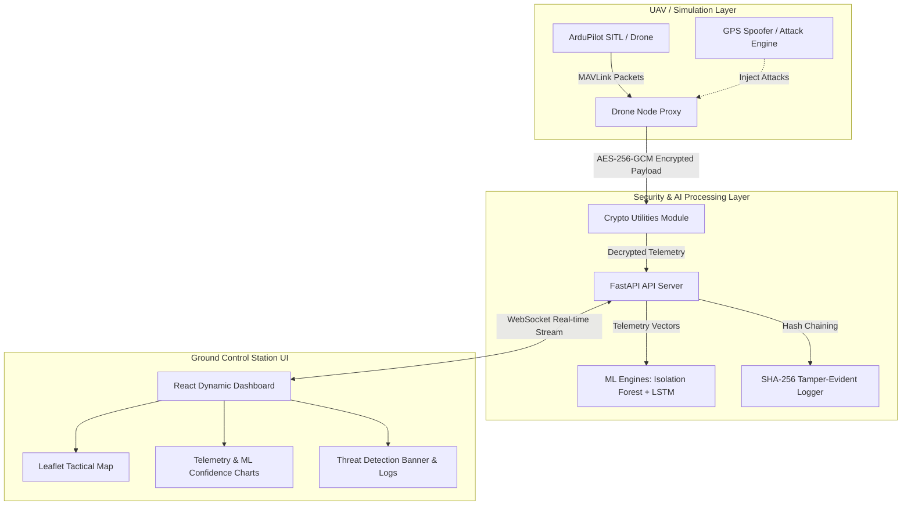

# 🛸 Secure Drone System

> **A Cyber-Physical UAV Security & Intelligent Telemetry Monitoring Architecture**  
> Retrofitting legacy Unmanned Aerial Vehicle (UAV) datalinks with **AES-256-GCM authenticated encryption**, **Machine Learning anomaly detection** (Isolation Forest & LSTM Autoencoders), **SHA-256 tamper-evident flight logging**, and a modern **React-based Ground Control Station (GCS)**.

---

## 📌 GitHub Repository Description (About Section)
```text
Cyber-Physical UAV Defense Framework featuring AES-256-GCM encrypted MAVLink datalinks, real-time Machine Learning anomaly detection (Isolation Forest & LSTM) for GPS spoofing/command injection, SHA-256 tamper-evident logging, and a React GCS dashboard.
```

---

## 🚀 Key Features

* 🔐 **Authenticated Cryptographic Datalink**: AES-256-GCM encryption for MAVLink telemetry, eliminating plaintext eavesdropping and command forgery with zero noticeable latency overhead.
* 🤖 **Dual-Layer AI Anomaly Detection**:
  * **Isolation Forest**: Detects spatial outliers, rapid altitude jumps, and velocity anomalies associated with GPS spoofing attacks.
  * **LSTM Autoencoders**: Analyzes temporal sequential flight dynamics to intercept stealthy trajectory manipulations and unauthorized velocity changes.
* 📜 **Tamper-Evident SHA-256 Logging**: Cryptographically chained telemetry logs guarantee post-flight forensic integrity; any post-hoc alteration breaks the hash chain instantly.
* 🗺️ **Tactical Ground Control Station (GCS)**: Modern, high-performance React + Leaflet dynamic UI providing real-time trajectory mapping, security alerts, HUD flight instruments, and attack simulation toggles.
* 🛸 **ArduPilot SITL Interfacing**: Native support for ArduPilot Software-In-The-Loop (SITL) and DroneKit-Python for safe, repeatable cyber-attack simulation.

---

## 🏗️ System Architecture



---

## 📂 Project Structure

```text
secure-drone-system/
├── backend/
│   ├── api_server.py           # FastAPI WebSocket backend & GCS server
│   ├── drone_node.py           # Drone telemetry transmitter & state simulator
│   ├── gcs_node.py             # Ground Control Station telemetry receiver
│   ├── crypto_utils.py        # AES-256-GCM cryptography & SHA-256 logging
│   ├── lstm_detector.py        # LSTM Neural Network for sequence anomaly detection
│   ├── lstm_trainer.py         # Training script for LSTM model
│   ├── ml_trainer.py           # Isolation Forest model training module
│   ├── gps_spoofer.py          # GPS spoofing & signal tampering simulator
│   ├── sim_connect.py          # Interface for ArduPilot SITL / DroneKit
│   ├── telemetry_logger.py     # Log recorder & hash verification engine
│   ├── anomaly_model.pkl       # Pre-trained Isolation Forest model
│   └── lstm_model.pkl          # Pre-trained LSTM neural network weights
├── frontend/
│   ├── src/
│   │   ├── App.jsx             # Main dashboard controller & tab view
│   │   ├── LeafletMap.jsx      # Interactive map with drone flight path
│   │   ├── TacticalMap.jsx     # Tactical radar map visualization
│   │   ├── MissionControl.jsx  # Flight control & attack triggering UI
│   │   ├── AnalyticsPanel.jsx  # Real-time telemetry & ML confidence graphs
│   │   └── AlertHistory.jsx    # Intrusion log & threat history panel
│   ├── package.json            # Node.js dependencies & scripts
│   └── vite.config.js          # Vite build configuration
├── attack_config.json          # Live attack configuration state
├── project_report.md           # In-depth technical report & system specs
├── start_system.bat            # One-click Windows startup script
└── start_system.sh             # One-click Linux/macOS startup script
```

---

## 💻 Installation & Setup

### Prerequisites
* **Python 3.10+**
* **Node.js 18+** & **npm**
* *(Optional)* **ArduPilot SITL** & **Mission Planner** for real-time physics simulation.

---

### 🚀 Quick Start (Automated)

#### Windows
Double click `start_system.bat` or run in PowerShell:
```cmd
.\start_system.bat
```

#### Linux / macOS
```bash
chmod +x start_system.sh
./start_system.sh
```

---

### 🛠️ Manual Setup

#### 1. Backend Setup
```bash
cd backend
python -m venv venv

# Windows
.\venv\Scripts\activate
# Linux/macOS
source venv/bin/activate

pip install fastapi uvicorn websockets scikit-learn tensorflow pandas numpy pycryptodome dronekit
python api_server.py
```
*Backend runs at `http://localhost:8000` (WebSocket at `ws://localhost:8000/ws`).*

#### 2. Frontend Setup
Open a new terminal tab:
```bash
cd frontend
npm install
npm run dev
```
*Access the Ground Control Station UI at `http://localhost:5173`.*

---

## ⚡ Attack Vector Testing & Verification

1. Launch the **Backend Server** and **Frontend Dashboard**.
2. Navigate to **Mission Control** on the web dashboard.
3. Toggle attack scenarios to test defensive capabilities:
   * **GPS Spoofing**: Simulates coordinate jumps. The **Isolation Forest** engine detects spatial anomalies, triggering a high-priority red threat alert on the tactical map.
   * **Velocity Hijack**: Injects unnatural acceleration vectors. The **LSTM Model** detects sequence anomalies.
   * **Log Tampering Test**: Modifies flight logs post-hoc; the SHA-256 verification module immediately flags hash mismatch and data compromise.

---

## 🔬 Technologies Used

* **Language**: Python 3.10+, JavaScript (ES6+)
* **Backend**: FastAPI, Uvicorn, WebSockets
* **Security & Cryptography**: PyCryptodome (AES-256-GCM, SHA-256)
* **Machine Learning**: Scikit-learn (Isolation Forest), TensorFlow/Keras (LSTM), Pandas, NumPy
* **Frontend**: React, Vite, Leaflet, Tailwind CSS, Lucide Icons
* **Simulation**: ArduPilot SITL, DroneKit-Python, MAVLink

---

## 📄 License
Distributed under the MIT License. See `LICENSE` for details.
